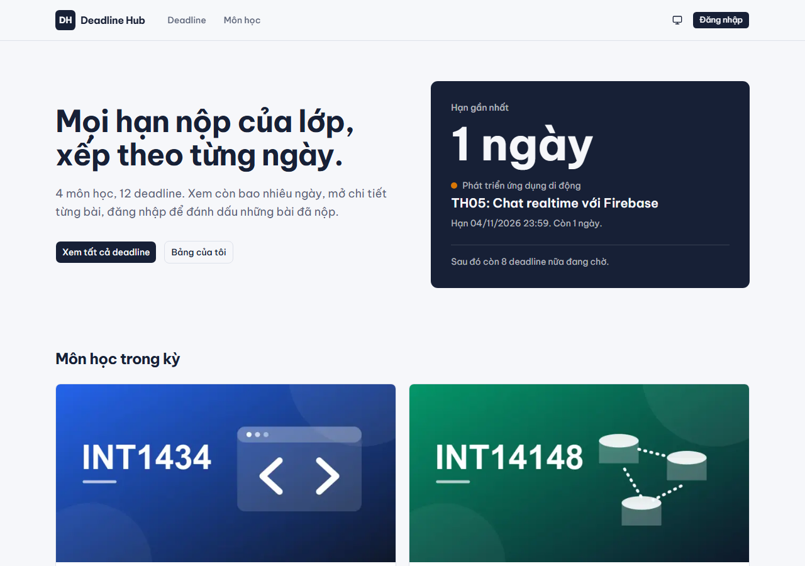
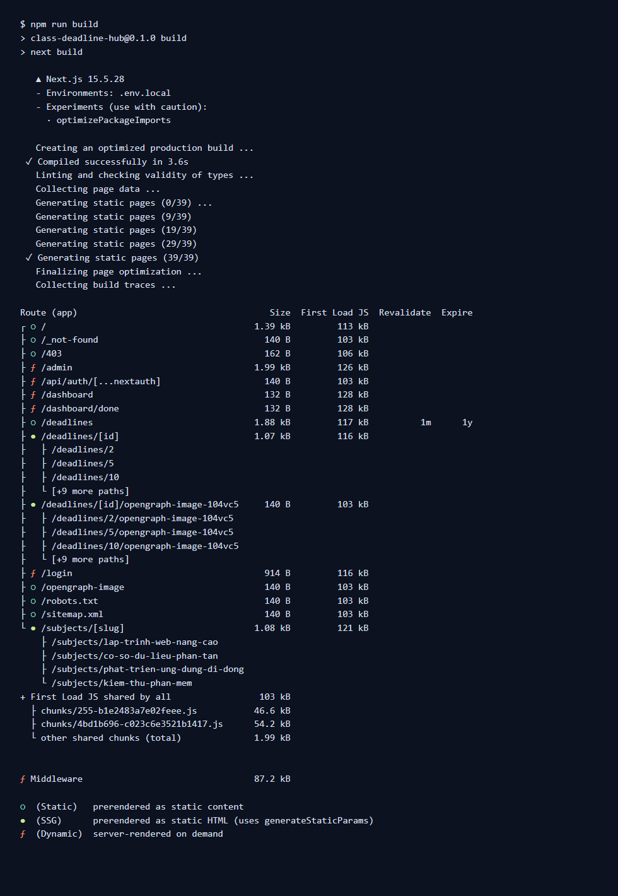
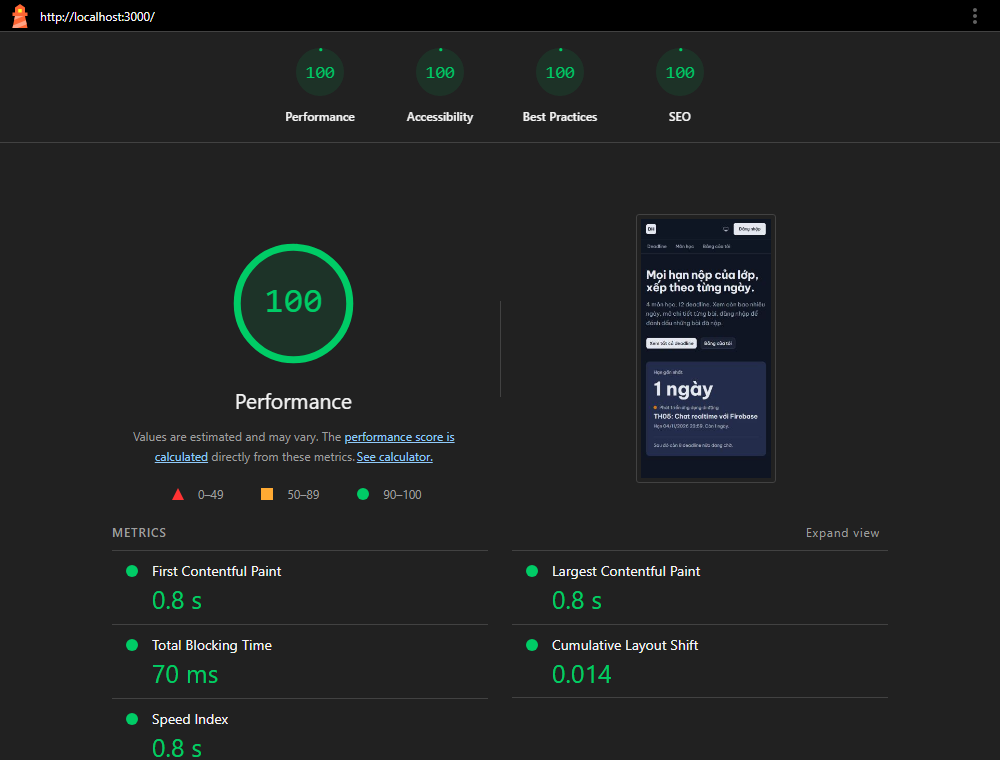
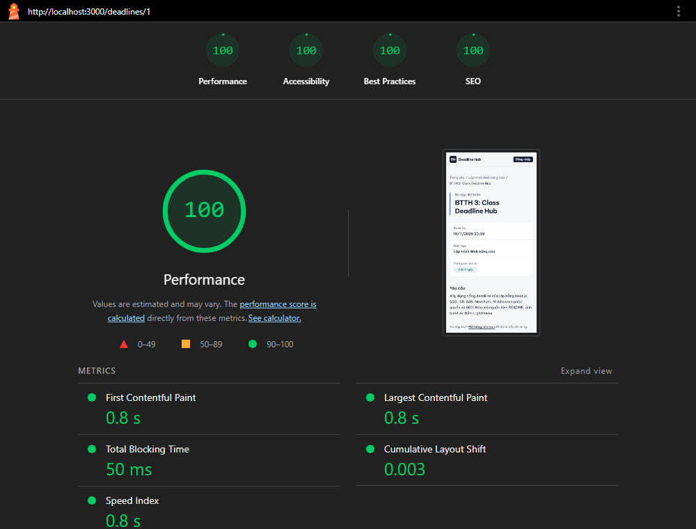
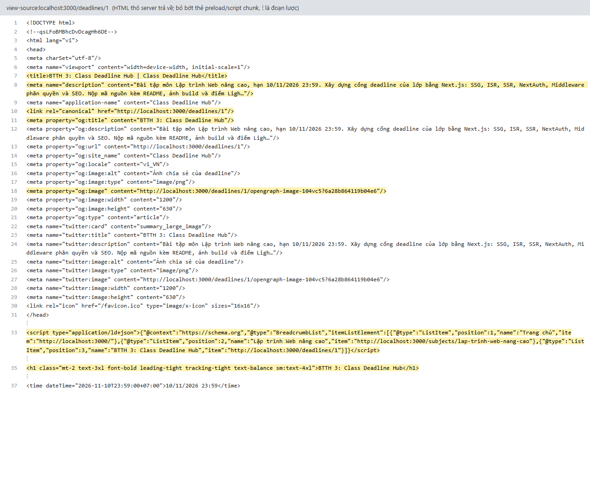
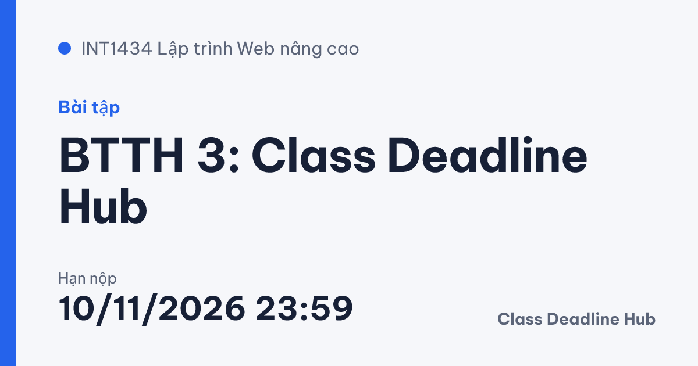

# Class Deadline Hub

Cổng web deadline của lớp. Bài thực hành 3, Lập trình Web nâng cao (Buổi 7–8).

- Ai cũng xem được deadline công khai. Mỗi deadline có ảnh chia sẻ riêng, có trong sitemap và structured data.
- Sinh viên đăng nhập để đánh dấu deadline đã xong.
- Lớp trưởng (admin) thêm và xoá deadline. Trang công khai được làm mới ngay.

Công nghệ: Next.js 15.5 (App Router), React 19, TypeScript, Tailwind CSS v4, shadcn/ui, Auth.js v5 (NextAuth), zod, Jest.



## Cách chạy

Yêu cầu Node.js 20 trở lên.

```bash
npm install
cp .env.example .env.local      # rồi điền AUTH_SECRET (tạo bằng: npx auth secret)
npm run build
npm start                        # http://localhost:3000
```

Các lệnh khác:

| Lệnh | Việc |
| --- | --- |
| `npm run dev` | Chạy chế độ phát triển |
| `npm test` | Chạy 64 test Jest (ma trận `can()`, dữ liệu, schema, đếm ngược, đăng nhập, SEO) |
| `npm run lint` | ESLint |
| `node scripts/hash-password.mjs <mật khẩu>` | Băm mật khẩu để thêm tài khoản vào `data/users.json` |

Tài khoản có sẵn:

| Email | Mật khẩu | Vai trò |
| --- | --- | --- |
| admin@ptit.edu.vn | admin123 | admin (lớp trưởng) |
| sv@ptit.edu.vn | sv123456 | user (sinh viên) |

Dữ liệu nằm trong `data/*.json` (4 môn, 12 deadline). Mật khẩu được lưu dạng băm bcrypt, không lưu dạng thô.

## Kết quả `npm run build` và chiến lược render



| Route | Truy cập | Chiến lược | Ký hiệu khi build | Lý do |
| --- | --- | --- | --- | --- |
| `/` | Mọi người | SSG | `○` Static | Nội dung chung cho mọi người, chỉ đổi khi admin sửa dữ liệu. Sinh HTML một lần lúc build nên tải nhanh nhất và bot đọc được ngay. "Hạn gần nhất" phụ thuộc ngày hôm nay nên được chọn ở client sau khi tải. Server Action thêm/xoá vẫn gọi `revalidatePath("/")` để số liệu không bị cũ. |
| `/subjects/[slug]` | Mọi người | SSG | `●` SSG | Chỉ có 4 môn, biết trước lúc build qua `generateStaticParams`. Slug lạ gọi `notFound()`. |
| `/deadlines` | Mọi người | ISR 60 giây | `○` + Revalidate `1m` | Danh sách thay đổi thường xuyên nhưng không cần tức thời. `revalidate = 60` phục vụ HTML có sẵn trong cache, quá 60 giây thì sinh lại ở nền. |
| `/deadlines/[id]` | Mọi người | ISR theo yêu cầu (on-demand) | `●` SSG | 12 trang sinh sẵn, `revalidate = false` nên không tự hết hạn theo thời gian. Khi admin thêm/xoá, Server Action gọi `revalidatePath` để làm mới ngay. Id mới thêm được render lần đầu khi có người mở (`dynamicParams = true`). Id không tồn tại trả HTTP 404 kèm trang 404 của dự án. |
| `/dashboard` | Đã đăng nhập | SSR | `ƒ` Dynamic | Nội dung riêng của từng người (đã xong, quá hạn) nên phải render theo phiên ở mỗi request. |
| `/admin` | Chỉ admin | SSR | `ƒ` Dynamic | Phải kiểm tra quyền ở mỗi request trước khi đọc dữ liệu. Không được cache để không lộ cho người khác. |

## Điểm Lighthouse (bản production, chế độ Mobile)

Đo bằng Lighthouse 13.6 trên `npm run build && npm start`. Báo cáo đầy đủ nằm trong [`docs/lighthouse/`](docs/lighthouse).

| Trang | Performance | Accessibility | Best Practices | SEO | LCP | CLS | TBT |
| --- | --- | --- | --- | --- | --- | --- | --- |
| `/` | 100 | 100 | 100 | 100 | 0.8 s | 0.021 | 80 ms |
| `/deadlines/1` | 100 | 100 | 100 | 100 | 0.8 s | 0.003 | 50 ms |




## View-source của `/deadlines/1`

HTML do server trả về đã có sẵn `<title>`, `description`, `canonical`, `og:image` (ảnh 1200×630 sinh bởi `opengraph-image.tsx`) và JSON-LD `BreadcrumbList`. Bot không cần chạy JavaScript vẫn đọc được.



> Ảnh trên được dựng từ HTML thô lấy bằng `curl http://localhost:3000/deadlines/1` (đúng nội dung mà view-source hiển thị), đã lược bớt các thẻ preload/script chunk. Có thể thay bằng ảnh chụp Ctrl+U trên trình duyệt.

Ảnh chia sẻ của deadline 1 (`/deadlines/1/opengraph-image`):



## Trả lời câu hỏi

### (1) Vì sao `/deadlines/[id]` dùng ISR?

Trang chi tiết deadline là trang công khai, cần SEO và cần mở nhanh khi được chia sẻ, nên phải có HTML sẵn như trang tĩnh. Nhưng nội dung lại thay đổi khi lớp trưởng thêm hoặc xoá deadline.

- **SSG thuần**: dữ liệu bị đóng băng tới lần build sau. Deadline mới thêm sẽ không có trang, deadline đã xoá vẫn còn hiện.
- **SSR**: lúc nào cũng mới, nhưng mỗi lượt xem đều phải render lại trên server, trong khi nội dung gần như không đổi giữa các lượt xem. Thời gian phản hồi (TTFB) và chi phí server đều tăng.
- **ISR theo yêu cầu**: lấy được cả hai cái lợi. Người xem luôn nhận HTML từ cache (nhanh như SSG, bot đọc được ngay). Trang chỉ được sinh lại đúng lúc dữ liệu đổi: Server Action thêm/xoá gọi `revalidatePath("/(public)/deadlines/[id]", "layout")`. Không cần chờ một khoảng thời gian cố định, và cũng không render lại khi không có gì thay đổi. Deadline mới có id chưa sinh lúc build vẫn được render lần đầu khi có người mở (`dynamicParams = true`), sau đó được cache lại.

### (2) Nếu chỉ dùng Middleware để bảo vệ `/admin` thì có rủi ro gì?

Middleware chỉ là lớp chặn đầu tiên. Nếu chỉ dựa vào nó:

1. **Server Action là endpoint công khai.** Ai biết action id đều gọi được bằng một request POST kèm header `Next-Action`, không cần mở trang `/admin`. Matcher của Middleware chỉ khớp theo đường dẫn trang, không bảo vệ chính hành động ghi dữ liệu. Dự án đã thử: dùng cookie của tài khoản sinh viên gọi thẳng `deleteDeadlineAction` bằng curl thì nhận `{"ok":false,"error":"Bạn không có quyền thực hiện thao tác này."}` và dữ liệu không đổi. Có kết quả này là vì action tự kiểm tra quyền, không phải nhờ Middleware.
2. **Matcher dễ cấu hình sai hoặc thiếu.** Chỉ cần thêm route mới (ví dụ `/quan-tri` hay một Route Handler `/api/...`) mà quên cập nhật `matcher` là route đó mở toang.
3. **Middleware có thể bị vượt qua.** Lỗ hổng CVE-2025-29927 của Next.js cho phép bỏ qua Middleware chỉ bằng header `x-middleware-subrequest`. Ai chỉ kiểm tra quyền ở Middleware lúc đó bị lộ toàn bộ trang quản trị.
4. **Middleware chỉ kiểm tra nhẹ.** Nó chạy ở Edge, chỉ đọc cookie JWT, không kiểm tra dữ liệu đầu vào. Dữ liệu xấu (id kiểu `../users`, ngày sai định dạng) vẫn lọt tới nơi ghi file nếu action không tự kiểm tra.

Vì vậy dự án bảo vệ nhiều lớp (defense in depth):

- `middleware.ts` chuyển hướng sớm cho trải nghiệm tốt.
- Trang `/admin` tự gọi `requirePermission("deadline:create")` trước khi đọc dữ liệu.
- Mọi Server Action đều chạy đủ: kiểm tra phiên, gọi `can(role, action)`, kiểm tra dữ liệu bằng zod, rồi mới ghi.

## Đối chiếu yêu cầu với mã nguồn

| Yêu cầu | Thực hiện ở |
| --- | --- |
| A1. Chiến lược render từng route | `src/app/(public)/page.tsx`, `subjects/[slug]/page.tsx`, `deadlines/page.tsx` (`revalidate = 60`), `deadlines/[id]/page.tsx` (`revalidate = false`), `src/app/(app)/dashboard/page.tsx` và `admin/page.tsx` (`dynamic = "force-dynamic"`) |
| A2. Id không tồn tại hiện 404 của dự án | `notFound()` trong các page + `src/app/not-found.tsx` (trả HTTP 404) |
| B1. Route group `(public)` và `(app)`, mỗi nhóm một layout | `src/app/(public)/layout.tsx`, `src/app/(app)/layout.tsx` |
| B2. `/dashboard` có sidebar lồng nhau, tô sáng trang hiện tại | `src/app/(app)/dashboard/layout.tsx`, `src/components/dashboard-nav.tsx` (`usePathname`, `aria-current`) |
| B3. loading, error ("Thử lại"), not-found | `src/app/(app)/loading.tsx`, `src/app/(public)/error.tsx`, `src/app/(app)/error.tsx`, `src/app/not-found.tsx` |
| B4. Mặc định Server Component, `'use client'` chỉ khi cần | Client: `countdown.tsx`, `deadline-filter.tsx`, `next-up.tsx`, `dashboard-nav.tsx`, `header/user-menu.tsx`, `login-form.tsx`, `toggle-done-button.tsx`, `admin/*`, `providers.tsx`, `error.tsx` |
| C1. NextAuth Credentials, session JWT | `src/auth.config.ts` (`strategy: "jwt"`), `src/auth.ts`, `src/app/api/auth/[...nextauth]/route.ts` |
| C2. id và role trong session, kiểu đầy đủ | `src/types/next-auth.d.ts` (`Role = "admin" \| "user"`), callbacks `jwt` / `session` |
| C3. Header hiện tên, vai trò, Đăng nhập/Đăng xuất | `src/components/header/user-menu.tsx` |
| D1. Ma trận quyền một nơi, `can(role, action)` | `src/lib/permissions.ts`, test `__tests__/permissions.test.ts` |
| D2. Middleware bảo vệ, giữ đường dẫn quay lại, user vào `/admin` thì sang `/403` | `src/middleware.ts`, `src/app/(public)/403/page.tsx` |
| D3. Page và mọi Server Action tự kiểm tra quyền, validate đầu vào | `src/lib/guards.ts`, `src/lib/action-guard.ts`, `src/actions/deadlines.ts`, `src/lib/schemas.ts` (zod) |
| E1. Metadata động + ảnh chia sẻ từng deadline | `generateMetadata` trong `deadlines/[id]/page.tsx`, `deadlines/[id]/opengraph-image.tsx` |
| E2. sitemap (mọi deadline), robots chặn `/dashboard` `/admin`, `/login` `/dashboard` noindex | `src/app/sitemap.ts`, `src/app/robots.ts`, `metadata.robots` trong login và dashboard |
| E3. JSON-LD BreadcrumbList | `src/lib/seo.ts`, `src/components/json-ld.tsx` |
| E4. next/font tiếng Việt, next/image | `src/app/layout.tsx` (Be Vietnam Pro, subset `vietnamese`), ảnh môn học trong trang chủ và trang môn |
| E5. Lighthouse bản production | Mục "Điểm Lighthouse" ở trên |

## Điểm cộng

- **Test Jest cho `can()`**: `__tests__/permissions.test.ts` kiểm tra đủ 12 ô của ma trận. Toàn bộ bộ test: `npm test` (64 test).
- **Đăng nhập GitHub (OAuth)**: chỉ bật khi có biến môi trường, nút "Đăng nhập với GitHub" chỉ hiện lúc đó. Tài khoản GitHub luôn có vai trò sinh viên. Cách bật:
  1. Vào GitHub, mở Settings › Developer settings › OAuth Apps › New OAuth App.
  2. Homepage URL: `http://localhost:3000`. Authorization callback URL: `http://localhost:3000/api/auth/callback/github`.
  3. Điền `AUTH_GITHUB_ID` và `AUTH_GITHUB_SECRET` vào `.env.local`, rồi chạy lại `npm start`.
- **Deploy Vercel**: chưa làm. Lưu ý: filesystem trên Vercel chỉ đọc được, nên các thao tác ghi file JSON (đánh dấu xong, thêm/xoá) sẽ không lưu lại. Bản deploy chỉ phù hợp để xem, đăng nhập và kiểm tra SEO.

## Cấu trúc thư mục

```
data/                       Dữ liệu JSON (môn học, deadline, tài khoản, trạng thái đã xong)
assets/fonts/               Font Be Vietnam Pro (.woff) cho ảnh chia sẻ
scripts/                    Băm mật khẩu, sinh ảnh bìa môn học
src/
  auth.config.ts, auth.ts   Cấu hình Auth.js (bản nhẹ cho Edge và bản đầy đủ)
  middleware.ts             Bảo vệ /dashboard, /admin
  actions/                  Server Actions: đăng nhập/đăng xuất, đánh dấu xong, thêm/xoá
  app/(public)/             Trang công khai: /, /subjects, /deadlines, /login, /403
  app/(app)/                Trang cần đăng nhập: /dashboard (sidebar), /admin
  components/               Component giao diện (Server mặc định, Client khi cần tương tác)
  lib/                      permissions, guards, data, schemas, seo, countdown
  types/next-auth.d.ts      Mở rộng kiểu Session/JWT
__tests__/                  Test Jest
docs/                       Ảnh chụp, báo cáo Lighthouse, kế hoạch
```
